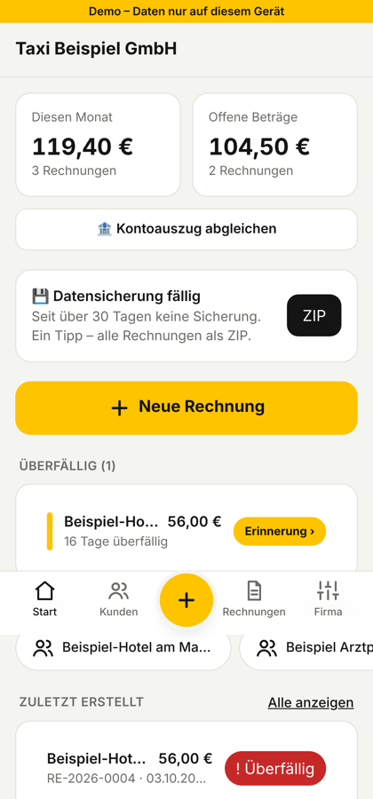
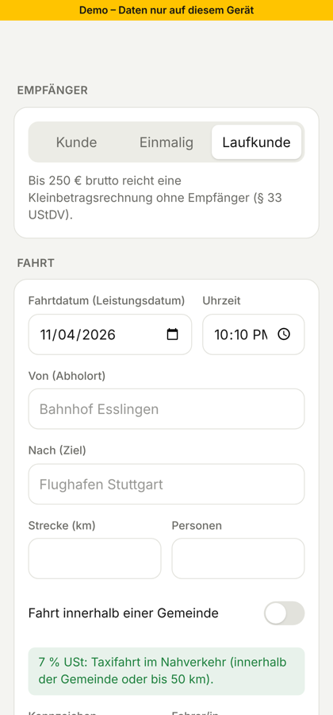
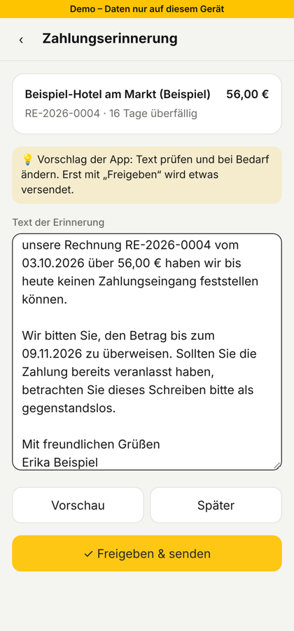

# TaxiRechnung

Invoice app for taxi companies in Germany. It's a mobile web app (PWA): it runs in any phone browser and can be installed to the home screen on Android and iPhone.

<p>
  
  
  
</p>

Live at [rechnung.altbachertaxi.de](https://rechnung.altbachertaxi.de), used by Altbacher Taxi.

**Stack:** React 19 · TypeScript · Vite · Tailwind · TanStack Query · Supabase (Postgres, Auth, Row Level Security, Storage, Edge Functions) · Vitest · Playwright · Docker Compose · GitHub Actions

## Features

- Each taxi company creates an account and enters its company details once. These go on every invoice.
- Customer database: regular customers (business or private) with search, customer numbers, notes and a default cost centre.
- Invoice creation for:
  - regular customers
  - one-time recipients (with the option to save them as a customer)
  - walk-in customers with no name (small-amount invoice up to €250)
- Trip details: date, time, from, to, km, passengers, licence plate, driver.
- VAT is suggested automatically: **7 %** within one municipality or up to 50 km, **19 %** above that. You can override it per item.
- Small business (§ 19 UStG) mode, which shows no VAT on invoices and adds the legal note.
- The PDF is built in the browser and sent through the phone's **share menu** (Mail, WhatsApp, …). There is also a direct download.
- **Repeat invoice**: one tap creates a new invoice with the same customer, route and prices.
- Status tracking (paid, open, overdue) and **cancellation invoices (Storno)**.
- CSV export for the tax advisor, plus a JSON backup.
- Interface in German and English. Invoices are always in German.
- Dark mode.
- **Driver accounts**: the owner invites drivers with a one-time code. Drivers create invoices and customers and tick payments; settings, bank, cancellations and backups stay with the owner. Each invoice records who issued it.
- **Overdue list + payment reminders**: the start screen lists overdue invoices, most urgent first. The app drafts a reminder (Zahlungserinnerung → 1. Mahnung → 2. Mahnung); you check or edit the text, and only "Approve & send" shares the PDF (+ the original invoice). Count and date are stored.

### German invoice rules covered

| Rule | How the app handles it |
|---|---|
| § 14 Abs. 4 UStG mandatory fields | Seller name and address, Steuernummer/USt-IdNr. (one of them is required at setup), recipient, invoice date, sequential number, type of service, service date (trip date), net amount per VAT rate, VAT rate and VAT amount |
| § 33 UStDV small-amount invoice (≤ €250 gross) | Walk-in invoices without a recipient are allowed only up to €250. Above that, a name and address are required |
| § 12 Abs. 2 Nr. 10 UStG | 7 % / 19 % taxi rate suggested from km and the municipality toggle |
| § 19 UStG | Small-business switch prints "Gemäß § 19 UStG wird keine Umsatzsteuer berechnet." |
| GoBD | Invoice numbers have no gaps (`RE-2026-0001`, counted per year and assigned in the database). Issued invoices cannot be edited or deleted; you correct them with a Storno. The seller data is frozen into each invoice |
| GoBD archive | On first opening after issue, the PDF (+ XRechnung XML for business customers) is stored in the Storage bucket `archive`. Policies allow insert + read only: archived files can never be overwritten or deleted. `archived_at` is locked once set |
| Retention (8 years, § 14b UStG / § 147 AO) | Data stays in the database. "Firma → Datensicherung" downloads a ZIP with all PDFs, XRechnung files, CSV and JSON; the dashboard reminds after 30 days |
| E-Rechnung (EN 16931) | Business customers (with company name) get an "XRechnung (XML)" download: XRechnung 3.0, CII syntax. Validated against the EN 16931 XSD + Schematron and the BR-DE rules (`tests/validate_xrechnung.py`) |
| GoBD Verfahrensdokumentation | "Firma → Verfahrensdokumentation (PDF)" creates a pre-filled template the company completes and signs |
| DSGVO / legal | Impressum, Datenschutzerklärung, AGB and AVV (Art. 28 DSGVO) under `#/legal/…`; new companies must accept AGB + AVV; when `TERMS_VERSION` changes, everyone must accept again |

> E-Rechnung: invoices up to €250 are exempt. Since 2025 every business must be able to *receive* e-invoices; the obligation to *issue* them for B2B starts in 2027 (turnover above €800k) or 2028 (everyone).
>
> This is not tax advice. Have a Steuerberater review your invoice template once.

## Two modes

| Mode | When | Data |
|---|---|---|
| **Demo** | No Supabase keys set | Stored only in this browser (localStorage) |
| **Cloud** | `VITE_SUPABASE_URL` + `VITE_SUPABASE_ANON_KEY` set | Supabase Postgres with login, and each company only sees its own data |

## Run locally

```bash
npm install
npm run dev          # http://localhost:5173 (demo mode without .env)
```

## Go live (about 15 minutes, free tiers)

1. **Supabase**: create a project at supabase.com.
   - Open SQL Editor → New query, paste `supabase/schema.sql` and click **Run**.
   - Under Authentication → URL Configuration, set the Site URL to your app domain (needed for confirmation and password-reset mails).
   - Under Project Settings → API, copy the *Project URL* and the *anon public* key.
2. **Configure**: copy `.env.example` to `.env` and paste in both values.
3. **Deploy** on Vercel or Netlify. Import the repo, keep the build command `npm run build` and the output folder `dist`, and add the two env variables there too.
4. On a phone, open the URL:
   - Android (Chrome): menu ⋮ → *Zum Startbildschirm hinzufügen*
   - iPhone (Safari): Share → *Zum Home-Bildschirm*

## Payment by bank transfer + "paid" tracking (no third party)

The money goes **straight to the company's own bank account**. No SumUp, PayPal or other payment provider is involved and there are no fees.

**For the customer** (on every open "Überweisung / Auf Rechnung" invoice):
- The PDF has a **GiroCode** (EPC QR code). When the customer scans it with their banking app, recipient, IBAN, amount and reference (`Rechnung RE-2026-0002`) are filled in automatically.
- There is also a **payment link** (`https://your-app/?pay=<secret token>`). It's added to the share message and to the PDF. It opens a page with the amount, the IBAN, BIC and reference (each with a copy button), the GiroCode and whether the invoice is already paid.

**For the company, without a bank connection: "Kontoauszug abgleichen"** (Rechnungen → 🏦 Abgleich)
1. In online banking, export your transactions as **CAMT** (XML) or **CSV**. Tested formats: Sparkasse CSV-CAMT, Volksbank/VR, ING, DKB and CAMT.053.
2. Choose the file in the app.
3. Incoming payments with the **invoice number in the reference and the exact amount** are marked **Bezahlt** with the booking date.
   - Partial payments, or payments with the right amount and customer name but no invoice number, appear under **"Bitte prüfen"** to confirm with one tap.
   - "Rückgängig" undoes a mark.

The file is read **on the device only**. It is never uploaded, and the app never logs in to the bank.

### Fully automatic: direct bank connection (FinTS)

Under *Firma → Automatischer Zahlungsabgleich* the company connects its account. Tested setup: **Volksbank with VR SecureGo plus**; this works with any bank that supports FinTS with an app approval method.

- The server checks the transactions **4 times a day** and you can tap **"Jetzt prüfen"** at any time. Matching payments set the invoice to **Bezahlt**, and the app updates live.
- The access is **read-only**. The code has no transfer function, and the login is stored AES-encrypted on the server. The app can only ever see the connection status.
- About **every 90 days** the bank asks for a new approval. The start screen then shows "Freigabe nötig": tap "Jetzt prüfen" and confirm in SecureGo plus. Until then, automatic checks pause, so you don't get stray push messages.
- If the bank rejects the login (for example a wrong PIN), automatic attempts stop immediately so the bank never locks the login.

**Setup:**
1. **FinTS product registration** (free; usually takes a few weeks): fints.org → Hersteller → Produktregistrierung. You get a product ID.
2. Run the latest `supabase/schema.sql`.
3. Set the secrets and deploy the function:
   ```bash
   supabase secrets set FINTS_PRODUCT_ID=<your product id> \
     BANK_CRED_KEY=$(openssl rand -base64 32) \
     CRON_SECRET=$(openssl rand -hex 24)
   supabase functions deploy bank-sync --no-verify-jwt
   ```
4. Schedule the checks (Supabase → Database → Extensions: enable `pg_cron` and `pg_net`, then SQL Editor). The times are UTC: 07, 11, 15 and 19 o'clock German winter time.
   ```sql
   select cron.schedule('bank-sync', '0 6,10,14,18 * * *', $$
     select net.http_post(
       url := 'https://<project-ref>.supabase.co/functions/v1/bank-sync/cron',
       headers := jsonb_build_object('Authorization', 'Bearer <CRON_SECRET>'),
       body := '{}'::jsonb)
   $$);
   ```
5. Turn on Realtime for the `invoices` table (the schema does this when the publication exists), so the app updates without reloading.

Good to know: banks limit automatic queries to a few per day, which is why the schedule runs 4 times. If you later offer automatic bank access to *other* companies, check the BaFin rules on account information services (ZAG). A licensed read-only provider such as finAPI is the usual route there.

Tests: `deno test supabase/functions/bank-sync/sync_test.ts` (simulated bank: SecureGo approval, 90-day renewal, wrong PIN, timeout, encryption).

Tests: `deno test --allow-read tests/bank_test.ts` (bank file parsing + matching).

## Go-live checklist before selling to other taxi companies

1. **Your details**: fill `src/legal/operator.ts` (name, address, email, phone, VAT status), then `npm run build` and upload. Missing fields are shown in red in the Impressum.
2. **Database update**: run the latest `supabase/schema.sql` in Supabase → SQL Editor (safe to run again; it only adds what's missing).
3. **Supabase Pro plan** (about $25/month): daily backups and no pausing after a week of inactivity. The free plan has neither, which is not acceptable for paying customers.
4. **Own email sender** (Supabase → Authentication → Emails → SMTP, e.g. your GoDaddy mailbox): needed for password reset and for turning "Confirm email" back on.
5. **Password rule**: Authentication → Policies → minimum length 8.
6. **AVV with your providers**: accept the Supabase DPA (Dashboard → Organization → Legal Documents) and GoDaddy's Data Processing Addendum.
7. **Your own business**: register a Gewerbe for the software service, and invoice your customers (the app can be used for that too).
8. Have a lawyer check the legal texts and a Steuerberater check the invoice template once. The texts are templates, not legal advice.

## Build commands

```bash
npm run build                 # PWA → dist/ (uses .env.production → live Supabase)
npx vite build --mode demo    # single-file demo → dist-demo/index.html
```

## Development: tests, Docker, CI (all free)

```bash
npm test                      # unit tests (Vitest): VAT maths, reminders
npm run test:db               # database: schema.sql = migrations, tenant isolation, roles, GoBD
docker compose up             # app on :5173 + PostgreSQL with the schema on :5432
docker compose run --rm db-test   # database tests inside Docker
```

- `supabase/migrations/` – one file per change, applied in order (Supabase CLI: `npx supabase db push`).
  `supabase/schema.sql` stays as the all-in-one file for the SQL Editor; the DB tests check that both
  produce exactly the same database.
- `.github/workflows/ci.yml` – runs types, unit tests, build, database tests, bank/FinTS tests and the
  XRechnung validation on every push (GitHub Actions, free).
- `docs/erd.md` – data model (Mermaid ERD), tenant boundary, uniqueness rules, auth flow.
- Server data in the app is managed with TanStack Query (`src/lib/queries.ts`): cached, refreshed live
  when the bank sync marks something paid, optimistic paid/open button.

## Project structure

```
src/
  lib/types.ts          data model (Company, Customer, Invoice …)
  lib/money.ts          cents math, VAT split, 7/19 % rule, € formatting
  lib/pdf.ts            German invoice PDF (jsPDF, DIN 5008 layout)
  lib/share.ts          Web Share API with download fallback
  lib/store/local.ts    demo store (localStorage)
  lib/store/supabase.ts cloud store
  lib/i18n.tsx          German / English
  pages/                Auth, Company, Dashboard, Customers, Invoices, InvoiceNew, InvoiceDetail
supabase/schema.sql     tables, RLS, gap-free numbering, GoBD protection, public payment page, bank connection
supabase/functions/bank-sync/   FinTS auto-check (lib-fints), encrypted login, cron
  lib/bank.ts           bank statement parsing (CAMT/CSV) + payment matching
  lib/qr.ts             GiroCode (EPC QR)
  lib/xrechnung.ts      XRechnung 3.0 (CII) generator
  lib/backup.ts         full backup ZIP
  lib/verfahrensdoku.ts GoBD process documentation PDF
  legal/operator.ts     YOUR details for Impressum/AGB/AVV + TERMS_VERSION
  legal/texts.ts        Impressum, Datenschutz, AGB, AVV
  lib/queries.ts        TanStack Query hooks (server data cache)
  lib/reminder.ts       overdue list, reminder proposal + PDF
  components/Team.tsx   invite drivers / join with code
tests/db/               database security tests
```

## Ideas for next steps

- ZUGFeRD (PDF with embedded XML) in addition to XRechnung
- Monthly collective invoice for hotels and companies (Sammelrechnung)
- Native store apps via Capacitor (same code)
- Sending email from the app (Resend / Supabase Edge Function)
