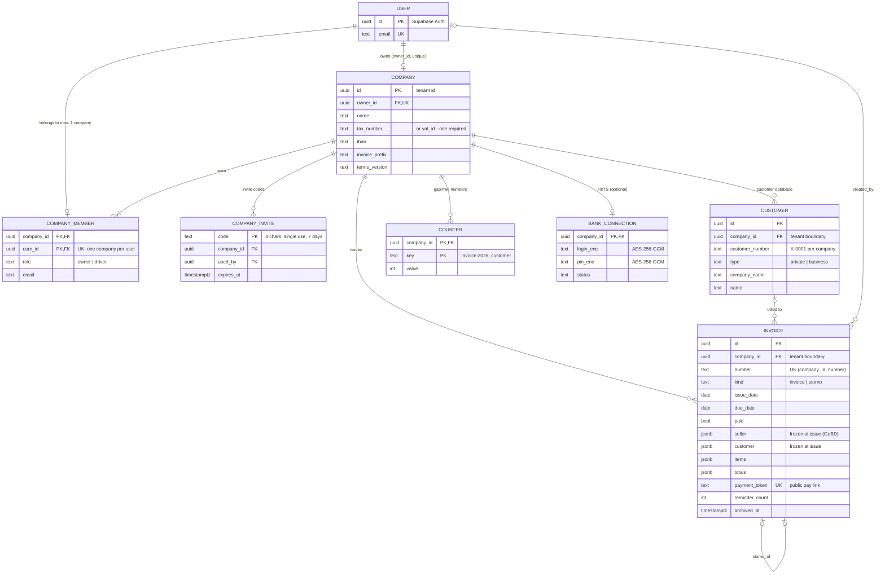

# Data model (ERD)

A taxi company is the **tenant**. Every row with customer or invoice data carries `company_id`,
and the database itself decides who may see it (Row Level Security), not the app.

Rendered: [erd.svg](erd.svg)

## Tenant boundary

- Every table with business data has `company_id`. RLS policies only return rows where
  `is_member(company_id)` is true for the logged-in user (`auth.uid()` from the JWT).
- A wrong or guessed id from another company returns nothing, the same as if it did not exist.
- Settings, bank connection, cancellations and invite codes need `is_owner(company_id)`.
- Writes that must be atomic (invoice number + insert, storno + cancel original, joining with a code)
  are `security definer` functions that check membership/ownership first.
- Covered by `tests/db/10_security.test.sql` (owner, driver, stranger, second tenant, anonymous).

## Uniqueness rules

| Rule | Why |
|---|---|
| `invoices (company_id, number)` unique, numbers from `counters` per company and year | gap-free invoice numbers (GoBD) |
| `company_members.user_id` unique | one company per login, so the app never has to ask "which company?" |
| `companies.owner_id` unique | one company per owner account |
| `company_invites.code` primary key, single use, expires after 7 days | invite codes can't be reused or guessed for long |
| `invoices.payment_token` unique, 36 hex chars | the public pay page only works with the secret link |

## Auth flow

1. Login with email + password (Supabase Auth) → short-lived JWT + refresh token.
2. Every request to the database carries the JWT; Postgres reads `auth.uid()` from it.
3. RLS + the functions above check membership/role on every query, also for the Edge Function
   (`bank-sync` checks that the caller is the owner before touching the bank login).
